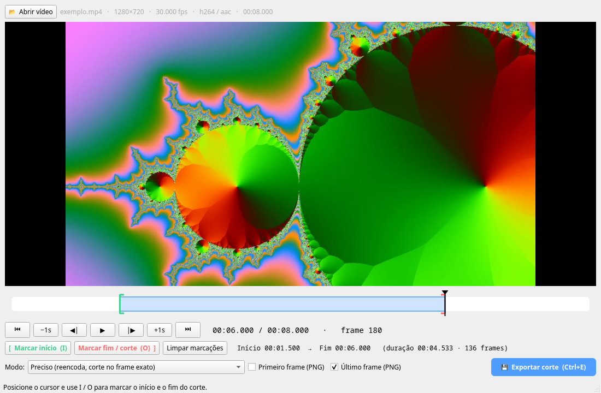
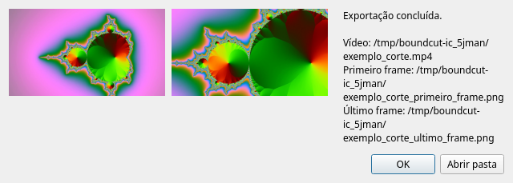

<p align="center"></p>

# BoundCut

**English** · [Português](README.pt-BR.md)

A simple video trimmer that, along with the cut, **saves the first and/or last frame of the clip** as PNG.



<p align="center"></p>

> The interface is in Brazilian Portuguese.

## Requirements

- Python 3.10+
- PyQt6 with QtMultimedia
- `ffmpeg` and `ffprobe` on the PATH

On Arch: `sudo pacman -S python-pyqt6 qt6-multimedia-ffmpeg ffmpeg`.
Elsewhere: `pip install PyQt6` and install ffmpeg with your package manager.

## Running

Straight from the repository (uses the system's PyQt6):

```bash
python boundcut.py              # open the window
python boundcut.py video.mp4    # open with a video loaded
./instalar-atalho.sh             # optional (Linux): app menu shortcut with icon
```

Or installed as a command (`boundcut`) in an isolated environment that brings its own PyQt6:

```bash
uv tool install git+https://github.com/FRubik/boundcut   # or: pipx install git+https://…
boundcut video.mp4
```

ffmpeg still comes from the system either way.

## Usage

1. Open a video (button, `Ctrl+O`, or drag the file onto the window).
2. Mark the segment: `I` sets the start, `O` sets the end (the cut point).
   The green/red brackets on the timeline can also be dragged.
3. `Ctrl+E` exports:
   - `name_corte.ext` — same container and codec as the original;
   - `name_corte_primeiro_frame.png` and/or `name_corte_ultimo_frame.png` — the first and last
     frame of the clip (the frames marked as start and end), depending on the checked boxes.

| Key | Action |
|---|---|
| Space | play / pause |
| ← / → | previous / next frame |
| Shift + ← / → | −1 s / +1 s |
| Home / End | go to cut start / end |
| I / O | mark start / end |

### Export modes

- **Preciso** (precise, default): re-encodes with the same codec at high quality (h264 → x264 CRF 18,
  hevc → x265, vp9, av1…). Frame-accurate cut. Audio is stream-copied when possible.
- **Rápido** (fast): stream copy, no re-encoding. Instant and lossless, but start/end may be off by
  a few frames (the cut depends on keyframes).

## Tests

```bash
python -m unittest -v    # from the project root; no dependencies beyond the app's own
```

- `tests/test_unidade.py` — unit tests for pure functions and UI logic (no ffmpeg needed).
- `tests/test_exportacao.py` — end-to-end: generates synthetic videos with ffmpeg, cuts them and checks
  container, codec, frame count, and that the saved PNGs really are the frames marked as start and end.
  Skipped if ffmpeg is not installed.

- `tests/test_projeto.py` — `pyproject.toml`, packaged files, README links and
  [Ruff](https://docs.astral.sh/ruff/) (lint + formatting; skipped without `ruff`/`uvx`).
  To fix formatting: `uvx ruff format .`

The UI runs with the `offscreen` platform during tests, so no window or display is needed.

The README screenshots are generated from the app itself: `python scripts/gerar_prints.py`
(re-run it when the UI changes).

## License

[MIT](LICENSE)
